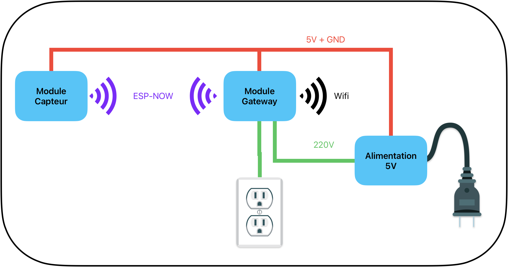
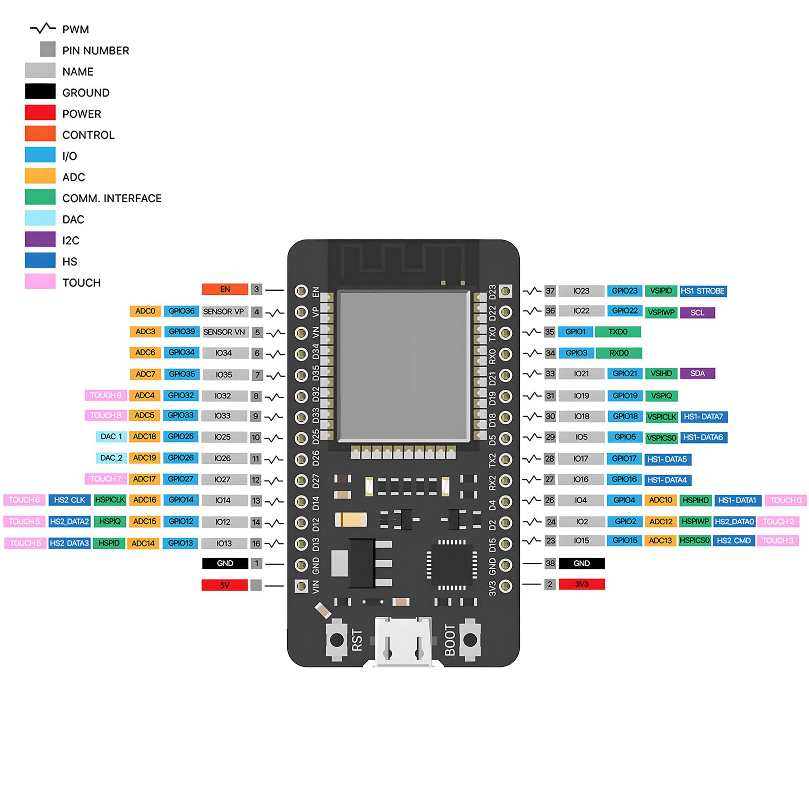
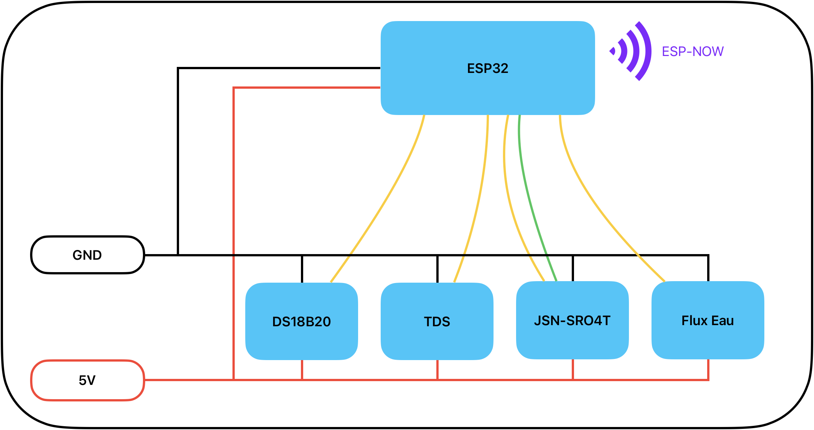
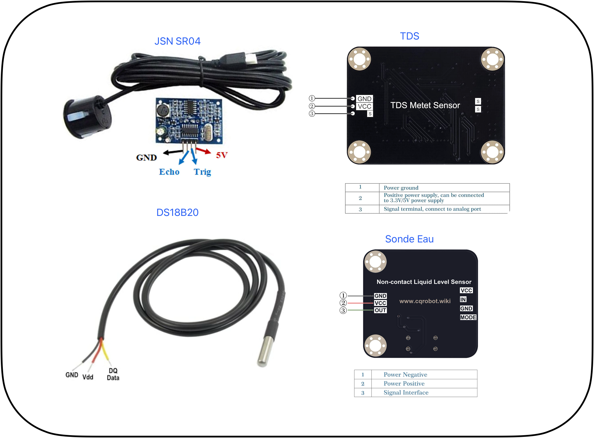
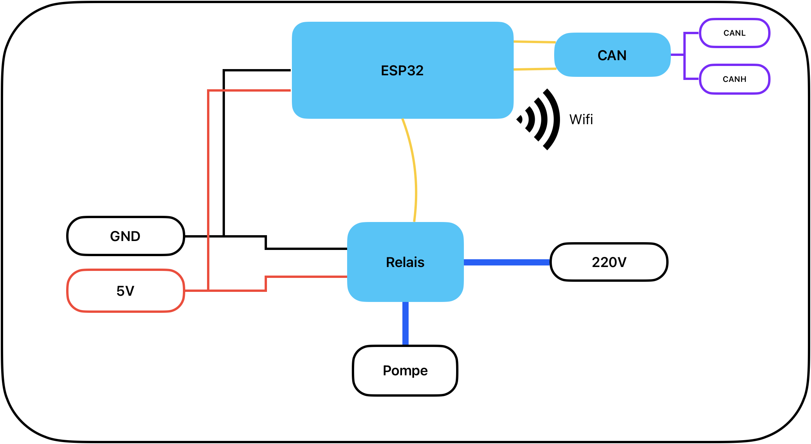

# HydroponX

HydroponX est un système de supervision et de pilotage d'une culture hydroponique.
Il est composé de deux modules électroniques basés sur des microcontrôleurs **ESP32**, reliés entre eux par un **bus CAN**, et d'une application **Node-RED** qui affiche les mesures, envoie des alertes et permet de commander les pompes à distance.

- **Module Capteur** : mesure l'état de l'eau du réservoir (température, conductivité, niveau, retour d'eau) et envoie ces mesures toutes les minutes sur le bus CAN.
- **Module Gateway** : relaie les mesures reçues sur le bus CAN vers un broker **MQTT** (via Wi-Fi) et pilote deux relais (pompes) à partir de commandes MQTT.
- **Node-RED** : s'abonne aux topics MQTT, affiche un tableau de bord (jauges, graphiques, état), envoie des notifications **Telegram** et publie les commandes des relais.

---

## Sommaire
- [Architecture](#architecture)
- [Contenu du dépôt](#contenu-du-dépôt)
- [Fonctionnement global](#fonctionnement-global)
- [Module Capteur](#module-capteur)
- [Module Gateway](#module-gateway)
- [Bus CAN](#bus-can)
- [Topics MQTT](#topics-mqtt)
- [Node-RED](#node-red)
- [Mise en route](#mise-en-route)
- [Licence](#licence)

---

## Architecture


```
 ┌──────────────── Module Capteur (ESP32) ───────────────┐
 │ DS18B20 · Sonde TDS · JSN-SR04T · Capteur présence eau │
 └───────────────────────────┬────────────────────────────┘
                             │ Bus CAN 500 kbit/s (toutes les 60 s)
 ┌───────────────────────────┴────────────────────────────┐
 │ Module Gateway (ESP32) ── Relais 1 / Relais 2 (pompes) │
 └───────────────────────────┬────────────────────────────┘
                             │ Wi-Fi · MQTT (hydro1/…)
                     ┌───────┴───────┐
                     │  Broker MQTT  │
                     └───────┬───────┘
                             │
             ┌───────────────┴────────────────┐
             │ Node-RED : dashboard, Telegram │
             └────────────────────────────────┘
```

---

## Contenu du dépôt

| Dossier / fichier | Contenu |
|-------------------|---------|
| [`PlatformIO-Capteur/`](PlatformIO-Capteur/README.md) | Firmware PlatformIO du Module Capteur (voir son README pour le détail du code) |
| [`PlatformIO-Gateway/`](PlatformIO-Gateway/README.md) | Firmware PlatformIO du Module Gateway (voir son README) |
| [`PlatformIO-Gateway/lib/ESPConnect/`](PlatformIO-Gateway/lib/ESPConnect/README.md) | Bibliothèque Wi-Fi (portail captif), MQTT et OTA utilisée par le Gateway |
| [`NodeRed/`](NodeRed) | Flows Node-RED (`data/flows.json`), réglages, dépendances et modèle de variables d'environnement (`.envTemp`) |
| [`Assets/Images/`](Assets/Images) | Schémas d'architecture, pinout de l'ESP32, photo du montage |
| `HydroponX.code-workspace` | Espace de travail VS Code regroupant les projets |

---

## Fonctionnement global

1. Toutes les **60 s**, le Module Capteur lit ses quatre capteurs et envoie quatre trames sur le bus CAN.
2. Le Module Gateway décode chaque trame selon son identifiant et publie la valeur sur le topic MQTT correspondant (`hydro1/waterTemp`, `hydro1/waterEc`, …).
3. Si le Gateway ne reçoit plus aucune trame CAN pendant **3 minutes**, il publie une erreur (retenue) sur `hydro1/error`, puis `OK` lorsque les trames reviennent.
4. Le Gateway publie aussi son état `online` / `offline` (Last Will) sur `hydro1/status`.
5. Node-RED reçoit tous les messages `hydro1/#`, met à jour le tableau de bord et prévient par Telegram en cas d'arrêt du flux d'eau, de changement d'état du Gateway ou d'absence de mesure.
6. Les boutons du tableau de bord publient `1` / `0` sur `hydro1/cmd/out1` et `hydro1/cmd/out2` ; le Gateway enclenche ou coupe le relais correspondant.

---

## ESP32 Pinout


---

## Module Capteur
Firmware : [`PlatformIO-Capteur`](PlatformIO-Capteur/README.md)



### Mesures

| Grandeur                 | Capteur                              | Valeur envoyée                                          |
|--------------------------|--------------------------------------|---------------------------------------------------------|
| Température de l'eau     | DS18B20 (OneWire)                    | °C (`-127` si le capteur ne répond pas)                 |
| Conductivité (EC)        | Sonde TDS CQRobot (ADC)              | µS/cm, compensée en température                         |
| Niveau d'eau             | JSN-SR04T (ultrason étanche)         | Distance capteur → surface de l'eau en **cm**, médiane de 9 mesures (`-1` en cas d'échec) |
| Retour d'eau dans le bac | Capteur de présence d'eau CQRobot    | `true` / `false`                                         |

La conversion de la distance en pourcentage de remplissage est faite dans Node-RED (voir [Configuration du réservoir](#configuration-du-réservoir)).

### Câblage
| Capteur             | Broche ESP32 | Remarques                          |
|---------------------|--------------|------------------------------------|
| DS18B20 Data        | GPIO 4       | Résistance pull-up 4.7 kΩ vers 5V  |
| DS18B20 VCC         | 5V           |                                    |
| DS18B20 GND         | GND          |                                    |
| Sonde TDS (signal)  | GPIO 34      |                                    |
| Sonde TDS VCC       | 5V           |                                    |
| Sonde TDS GND       | GND          |                                    |
| JSN-SR04T Trig      | GPIO 5       |                                    |
| JSN-SR04T Echo      | GPIO 18      | Diviseur de tension 5V → 3.3V      |
| JSN-SR04T VCC       | 5V           |                                    |
| JSN-SR04T GND       | GND          |                                    |
| Présence eau (signal) | GPIO 35    |                                    |
| Présence eau VCC    | 5V           |                                    |
| Présence eau GND    | GND          |                                    |
| Module CAN GND      | GND          | Transceiver SN65HVD230             |
| Module CAN VCC      | 3.3V         |                                    |
| Module CAN Rx       | GPIO 16      |                                    |
| Module CAN Tx       | GPIO 17      |                                    |



---

## Module Gateway
Firmware : [`PlatformIO-Gateway`](PlatformIO-Gateway/README.md)



### Fonctions
- **CAN → MQTT** : chaque trame reçue est décodée et publiée sur le topic correspondant (QoS 0, non retenu).
- **MQTT → relais** : souscription à `hydro1/cmd/#` (QoS 1) pour piloter les deux relais.
- **Surveillance du bus CAN** : publication de `CAN_TIMEOUT: aucun message du capteur` sur `hydro1/error` après 3 minutes sans trame.
- **Wi-Fi sans identifiants dans le code** : au premier démarrage, l'ESP32 ouvre le point d'accès `HydroponX-Setup` (portail captif, ou http://192.168.1.1) pour choisir le réseau Wi-Fi. Un appui de 2 s sur le bouton BOOT (GPIO 0) réinitialise le Wi-Fi.
- **Configuration MQTT depuis le navigateur** : page `http://<ip-esp32>/status` (broker, port, utilisateur, mot de passe, nom d'appareil), enregistrée en flash (NVS).
- **Mise à jour par le réseau (OTA)** : port 3232, protégée par un mot de passe défini dans `secrets.ini`.

### Câblage
| Composant         | Broche ESP32 | Remarques                          |
|-------------------|--------------|------------------------------------|
| Relais pompe 1    | GPIO 32      | Actif à l'état bas (LOW = pompe ON) |
| Relais pompe 2    | GPIO 33      | Actif à l'état bas (LOW = pompe ON) |
| Relais VCC        | 3.3V         |                                    |
| Relais GND        | GND          |                                    |
| Module CAN GND    | GND          | Transceiver SN65HVD230             |
| Module CAN VCC    | 3.3V         |                                    |
| Module CAN Rx     | GPIO 16      |                                    |
| Module CAN Tx     | GPIO 17      |                                    |

---

## Bus CAN
Débit : **500 kbit/s**, identifiants standards 11 bits. Le débit et les identifiants doivent être identiques dans les deux fichiers `src/Config.h`.

| ID CAN  | Type                         | Donnée                     |
|---------|------------------------------|----------------------------|
| `0x101` | float (4 octets IEEE 754)    | Température de l'eau (°C)  |
| `0x102` | float (4 octets IEEE 754)    | Conductivité (µS/cm)       |
| `0x103` | float (4 octets IEEE 754)    | Distance surface de l'eau (cm) |
| `0x104` | bool (1 octet `0x00`/`0x01`) | Retour d'eau présent       |

---

## Topics MQTT
Le préfixe `hydro1` correspond au nom d'appareil du Gateway (`CONFIG_DEVICE_NAME`).

### Publiés par le Module Gateway
| Topic                 | Exemple    | Description                                                     |
|-----------------------|------------|-----------------------------------------------------------------|
| `hydro1/waterTemp`    | `22.50`    | Température de l'eau (°C)                                       |
| `hydro1/waterEc`      | `1850.00`  | Conductivité (µS/cm)                                            |
| `hydro1/waterLevel`   | `34.20`    | Distance capteur → surface de l'eau (cm)                        |
| `hydro1/waterPresent` | `1`        | Retour d'eau présent (`1`) ou absent (`0`)                      |
| `hydro1/status`       | `online`   | État du Gateway : `online` (retenu, toutes les 60 s) ou `offline` (Last Will) |
| `hydro1/error`        | `OK`       | `CAN_TIMEOUT: aucun message du capteur` ou `OK` (retenu)        |

### Souscrits par le Module Gateway
| Topic             | Valeurs        | Description                                  |
|-------------------|----------------|----------------------------------------------|
| `hydro1/cmd/out1` | `1` / `ON`     | Relais 1 en marche ; toute autre valeur l'arrête |
| `hydro1/cmd/out2` | `1` / `ON`     | Relais 2 en marche ; toute autre valeur l'arrête |

---

## Node-RED
Dossier : [`NodeRed`](NodeRed) — prévu pour l'image Docker officielle de Node-RED (le dossier `data/` est monté sur `/data`).

### Dépendances (`data/package.json`)
- `@flowfuse/node-red-dashboard` (Dashboard 2) et `@flowfuse/node-red-dashboard-2-ui-led`
- `node-red-contrib-telegrambot`
- `node-red-contrib-influxdb`

### Variables d'environnement
Le fichier [`NodeRed/.envTemp`](NodeRed/.envTemp) sert de modèle : le copier en `.env`, le compléter et le fournir au conteneur Node-RED (par exemple via `env_file` dans docker compose).

| Variable | Utilisation |
|----------|-------------|
| `MQTT_URL`, `MQTT_PORT`, `MQTT_USER`, `MQTT_PAASSWORD` | Connexion au broker MQTT |
| `TELEGRAM_TOKEN`, `TELEGRAM_CHATID` | Bot Telegram et conversation qui reçoit les alertes |
| `INFLUX_URL`, `INFLUX_TOKEN`, `INFLUX_ORGA`, `INFLUX_BUCKET` | Base InfluxDB (utilisée par l'onglet `SemX`) |

### Onglets du flow (`data/flows.json`)
| Onglet | Rôle |
|--------|------|
| **MQTT Hydro1** | S'abonne à `hydro1/#`, décode le payload, aiguille chaque métrique vers son onglet et affiche l'heure du dernier message. Un topic non géré déclenche un message Telegram. |
| **Tremperature eau** / **EC eau** | Jauge, graphique (moyenne de 10 mesures, historique de 7 jours) et alerte Telegram si aucune mesure n'arrive pendant 4 minutes. |
| **Level eau** | Convertit la distance en pourcentage de remplissage, puis jauge, graphique et alerte comme ci-dessus. |
| **Présence eau** | LED (vert : flux détecté, rouge : arrêté, gris : pas de message depuis 4 min) et notification Telegram à chaque changement. |
| **Status** | LED d'état du Gateway (`online` / `offline`) et notification Telegram à chaque changement. |
| **Relay** | Boutons Marche / Arrêt qui publient sur `hydro1/cmd/out1` et `hydro1/cmd/out2`. |
| **Config** | Lecture et enregistrement des réglages du réservoir dans `/data/MySettings.txt`. |
| **Telegram** | Mise en forme des messages et file d'envoi (2 messages/s au maximum) vers le bot. |
| **SemX** | Flow d'un autre projet (`semix/#`) qui enregistre ses mesures dans InfluxDB. |

Le tableau de bord comporte trois pages : **HydroponX** (état et mesures), **Chart** (graphiques) et **Config**.

### Configuration du réservoir
Le capteur ultrason mesure une distance : plus elle est petite, plus le réservoir est plein. Node-RED la convertit en pourcentage à partir de deux valeurs réglables sur la page **Config** et enregistrées dans `MySettings.txt` :

| Paramètre             | Signification                              | Exemple |
|-----------------------|--------------------------------------------|---------|
| `ReservoirNiveauHaut` | Distance mesurée réservoir plein (100 %)   | `22` cm |
| `ReservoirNiveauBas`  | Distance mesurée réservoir vide (0 %)      | `57` cm |

`niveau % = (NiveauBas − mesure) / (NiveauBas − NiveauHaut) × 100`, borné entre 0 et 100.

---

## Mise en route

### Prérequis
- Deux cartes ESP32 (`esp32dev`), deux transceivers CAN SN65HVD230, les capteurs et un module relais décrits ci-dessus.
- [PlatformIO](https://platformio.org/) (extension VS Code ou CLI).
- Un broker MQTT et une instance Node-RED (Docker).

### 1. Module Capteur
Depuis le dossier `PlatformIO-Capteur` :

```bash
pio run -t upload
```

```bash
pio device monitor
```

### 2. Module Gateway
Depuis le dossier `PlatformIO-Gateway`, créer d'abord le fichier de secrets (mot de passe et adresse OTA, ignoré par git) puis le compléter :

```bash
cp secrets.ini.example secrets.ini
```

Premier téléversement par USB :

```bash
pio run -t upload
```

Mises à jour suivantes par le réseau :

```bash
pio run -e esp32dev_ota -t upload
```

Au premier démarrage, se connecter au Wi-Fi `HydroponX-Setup` pour choisir le réseau, puis ouvrir `http://<ip-esp32>/status` pour activer et configurer MQTT.

### 3. Node-RED
1. Copier `NodeRed/.envTemp` en `.env` et renseigner les valeurs.
2. Monter `NodeRed/data` sur `/data` dans le conteneur Node-RED et lui fournir les variables d'environnement.
3. Installer les dépendances de `package.json` (gestionnaire de palette ou `npm install` dans `/data`), puis redémarrer Node-RED.
4. Ouvrir le tableau de bord sur `http://<hôte>:1880/dashboard`.

---

## Licence
Projet distribué sous licence GNU GPL v3 — voir le fichier [LICENSE](LICENSE).
